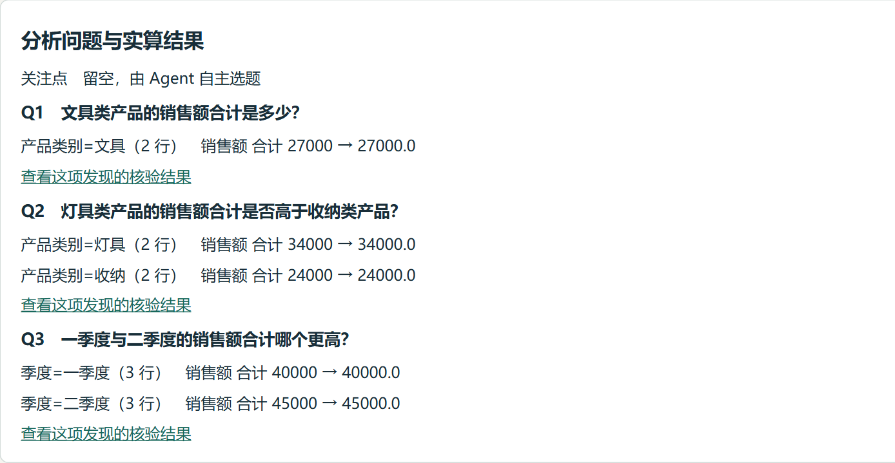

# 多 Agent 数据结论审查与复现系统

只有表格时，选择 **分析数据**。上传 CSV、留空关注点，分析 Agent 会自己提出问题，读取程序算出的数值，再让其余四个角色核验候选发现。已有分析稿时，选择 **核验结论**，逐行提交原句。两种模式都可下载 Markdown 报告与 JSON 复算记录。



## Windows 启动

在本目录的 PowerShell 中运行，实测 Python 3.13，运行时仅用标准库。

```powershell
python app.py
```

打开 http://127.0.0.1:8766/ ，首页默认是“分析数据”。从 [销售表](examples/sales.csv) 或 [转化表](examples/conversion.csv) 选择一份文件，“想了解什么”可不填。要核对已有稿件，打开 [核验结论](http://127.0.0.1:8766/?task=audit)。实时调用读取进程变量 `DEEPSEEK_API_KEY`，默认模型 deepseek-flash，可设 `DEEPSEEK_MODEL`。字段概况、类别示例、关注点、原句与汇总证据会发给模型服务；应用只监听本机。

无密钥时可直接看固定回放：[销售分析](http://127.0.0.1:8766/view?case=analysis-sales)、[转化分析](http://127.0.0.1:8766/view?case=analysis-conversion)、[关注点与缺失月份](http://127.0.0.1:8766/view?case=analysis-focus)、[原四角色分组争议](http://127.0.0.1:8766/view?case=injected)。

## 离线验收

```powershell
python -m unittest discover -s tests -v
python audit.py examples/sales.csv evidence/analysis-sales.json
python audit.py examples/conversion.csv evidence/multi.json
python experiments/score.py
```

复算程序使用原文件字节校验指纹，重做探索查询及各轮核验统计，检查候选发现关联和锁定判定。修改原数据或已记录的分母会触发校验错误。它不认证报告作者或签名。真实重跑使用 `python experiments/run.py multi local/repeat.json`（输出路径须未被占用），Web 上传验收使用 `python experiments/web_smoke.py`。自主分析的真实 HTTP 验收命令为 `python experiments/analysis_web.py examples/sales.csv local/new-sales.json`，可选 `--focus "比较文具的季度变化"`。以上重跑均调用模型。回放只读 evidence；浏览器发起的新运行保存在 local，下载后自行保留原 CSV。

目前支持至多 1 MB、10000 行、40 列的 UTF-8 CSV，等值筛选后的计数、合计、算术均值及部分占总体的百分比。跨期和跨组通过多条明确的筛选请求比较。未支持的统计推断、缺失字段及缺乏识别依据的因果主张应保留“证据不足”。

正式自主分析记录在 evidence/analysis-*.json，早期协议失败、口径分歧与开发试跑单列在 evidence/analysis-pilots/。

[课程报告](report.md) · [四行样例 CSV](examples/conversion.csv) · [实验方案](experiments/protocol.md) · [冻结评分](evidence/summary.json)

模型调用基于 [DeepSeek 官方 API](https://api-docs.deepseek.com/)。
