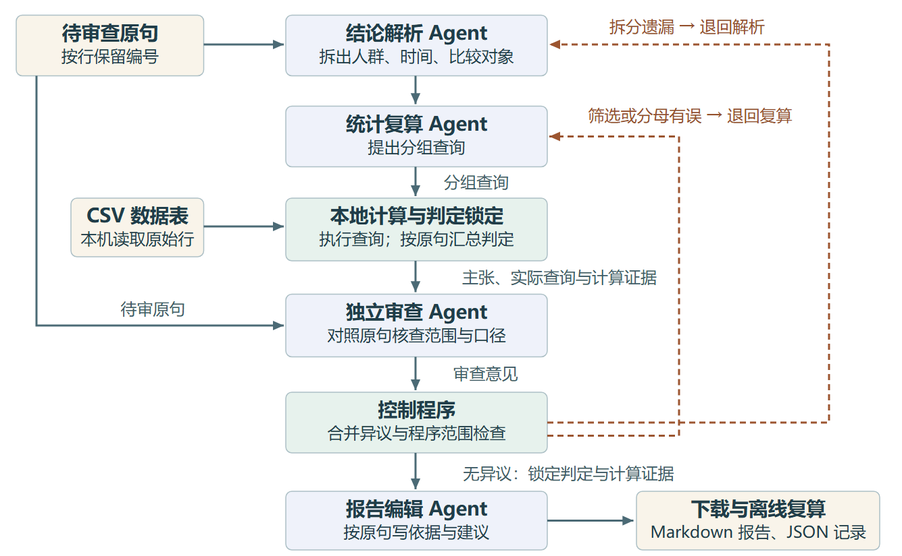

# 多 Agent 数据结论审查与复现系统

选题方向：方向三　多 Agent 协作系统（系统设计）

## 第一章　项目概述

### 1.1 方向选择理由

核对一份数据分析稿时，计算结果正确，仍可能得出错误的结论。“总体转化率上升”可以用两个月的总人数和转化人数核验，而“各类用户的转化率均上升”要求按用户类型分别比较。若提出计算方案的角色漏掉分组条件，另一个角色需要对照原句和实际查询指出偏差，要求补算。本题在“应用延伸”“工程锤炼”“系统设计”中选择第三个方向，重点考察这样的分工、反馈和修订能否纠正结论。

### 1.2 项目目标

本项目的目标是让分析文稿中的数据结论可以逐句核验，并由他人独立复算。对每条原句，系统给出“数据支持”“与数据矛盾”或“证据不足”的判定，并列出计算依据。实际查询遗漏了原句限定的人群时，系统应能指出缺失条件，发起补算并更新判定。审查结束后，复核者可以用原始 CSV 和导出记录，在本机重现统计结果。

### 1.3 核心功能

使用者在浏览器上传 CSV，逐行提交结论，查看每句的判定和修订建议。页面列出各轮计算，可以展开交接详情核对请求与回答，并下载 Markdown 审查报告和用于复算的 JSON 记录。

## 第二章　系统设计

### 2.1 系统架构图



*图 1　一次四角色审查的执行顺序。实线表示正常交接，虚线表示带异议进入下一轮。*

原始数据留在本机参与计算。审查角色同时取得原句、拆出的主张、实际执行的查询和计算证据，可以看出计算覆盖了哪些人。每轮先由程序按原句锁定当轮判定；只有审查意见和程序范围检查都没有提出问题，控制程序才将该判定和证据交付编辑。

### 2.2 模块说明

| 模块或角色 | 接收什么 | 实际交付 |
|---|---|---|
| 结论解析 Agent | 原句、字段和类别示例 | 带原句编号、人群、比较方向的原子主张 |
| 统计复算 Agent | 原子主张、上轮计算和反馈 | 规定格式的指标、分子分母与两侧筛选请求 |
| 本地统计程序 | 原 CSV 与结构化请求 | 匹配行数、实际分子分母、结果和数值比较 |
| 独立审查 Agent | 原句、拆分结果、实际执行的请求及证据 | 受影响的主张编号、异议、应补算的范围 |
| 报告编辑 Agent | 已核实的证据与锁定判定 | 每条原句的理由和可用的修订建议 |
| Web 端与记录 | 上传、模型事件与计算轮次 | 逐句页面、历史回放、Markdown 与 JSON 下载 |

一句话可对应多个原子主张，而原句编号保持不变。例如作者同时谈两类用户，编辑仍应交付对同一句话的审查结果，读者可以展开看到两份分组依据。系统保存模型提出的请求和程序实际执行的请求，因此人工删除筛选条件时也能查清改动发生在哪一步。

### 2.3 关键设计决策

按人群设置独立的左、右筛选条件，可以直接显示每一侧纳入了哪些行。只保存一个百分数会丢失分母，难以识别“本组人数”被换成“全体人数”的错误。为此，系统在计算时一起记录字段名、人数和命中行数。同一份记录也作为复核输入，避免编辑阶段重新猜测数字。

每条结论先由程序锁定判定，再交给编辑组织文字。各组均提升需要每个子主张成立；有一组被反证就能否定全称判断，某组缺数据且没有反证时则保留疑问。这样仍允许模型解释“不足在哪里”，又能防止一轮文字润色改变已经核实的判定。

## 第三章　实现细节

### 3.1 核心代码片段

以下三处摘自 `audit.py` 的 `audit`。先看一轮结束时，控制程序怎样合并两种意见：

```python
step["review"]=objections
step["program_checks"]=scope_issues(atoms,actual)
feedback=objections+step["program_checks"]
if not feedback:break
```

`actual` 是实际执行的请求。即使每一步除法都正确，只要请求缺了主张规定的人群，程序仍会生成范围异议。审查角色提出的意见单独保存在 `review` 中。两份意见均为空时，循环结束，编辑取得这一轮的判定。有异议时，程序保存刚才的查询和结果，供下一轮与新方案对照。

随后按退回对象决定是否先重拆原句：

```python
if any(i["target"]=="解析" for i in feedback):
    atoms=ask("解析",r+1,dict(previous_atoms=atoms,feedback=feedback),lambda o:check_atoms(o,len(lines)))
```

例如原句同时说到两个群体，解析时却只保留了一类，修订需要改变主张清单。若两类人群已经拆对，只是计算时忘记筛选，原清单可以沿用。两条路径都回到循环开头，统计角色在下一轮接收以下请求：

```python
if mode=="multi":qs=ask("复算",r,dict(atoms=atoms,feedback=feedback,previous=previous),lambda o:check_queries(o,atoms))
```

这里的 `feedback` 给出缺失条件，`previous` 提供上一次执行的查询和结果。重新提交的请求必须与当前原子主张一一对应，才能进入本地计算。如果相同主张、查询和异议对象再次出现，或第三轮仍有异议，系统停在待人工核查状态。

统计口径见 `stats.py` 的 `aggregate`。下列语句从同一批匹配行取得分子、分母：

```python
vals=[number(r[q["num"]]) for r in selected];num=sum(vals)
if metric=="均值": den=Fraction(len(vals))
if metric=="比例":
    counts=[number(r[q["den"]]) for r in selected]
    if any(n<0 or d<0 or n>d for n,d in zip(vals,counts)):raise ValueError("部分人数与总人数不一致")
    den=sum(counts)
```

`selected` 由月份、人群等全部等值条件共同确定。计算转化率时，分子累计这些行的转化人数，分母累计这些行的人数，最后相除并换算成百分比。这样保留了人数不同的组各自的权重。程序还逐行检查部分人数是否超过总人数；零分母和缺失字段都会留下具体原因，供报告说明证据为何不足。

### 3.2 关键配置

| 条件 | 配置与实验取值 | 影响 |
|---|---|---|
| 模型 | `DEEPSEEK_MODEL` 默认及实测均为 `deepseek-flash`；凭据变量 `DEEPSEEK_API_KEY` | 四种角色独立请求，共用服务 |
| 模型输出 | JSON 对象、温度 0；单次网络超时 90 秒 | 解析后检查必需字段和主张编号 |
| 运行边界 | 最多 3 轮复算；结构错误可带反馈重试一次 | 分歧重复或达到上限时停止定稿 |
| 数据范围 | UTF-8 CSV，最多 1 MB、10000 行、40 列 | 在本机执行计数、合计、均值、人数比例 |
| 实验 | 同一份四行 CSV、六条原句；一次性批量请求 | 单角色与多角色共用统计引擎和判定规则 |

模型取得字段、类别示例和需要核对的汇总结果。完整数据由本机读取。用户可将自然语言原句分行上传，其中一行即使包含多个比较，也只占一个最终判定。导出记录带有原始文件字节的指纹，换行或编码改变也会被识别为不同输入。一次运行中的服务耗时按实际调用累计，程序的本地计算和网页展示时间没有计入该数值。不同角色使用不同提示词，原始请求和可见回答按角色名称保存，使格式错误与统计口径错误能够分别定位。

### 3.3 遇到的问题与解决

早期单角色基线在最后一步失败。六条原句中，“新用户和老用户的转化率从4月到5月均有提升”需要分别核对新用户和老用户，因此产生七个原子计算，但撰稿人仍只需要六条逐句意见。日志显示计算已经完成，编辑却按七个原子编号各交付一条意见。即使两项分组判断都正确，这样的回答也无法直接对应分析稿中的第二句。

程序发现交付数量和编号不合要求，带着错误提示重试一次，仍未得到有效定稿。修正编辑提示后，单角色基线从头重跑，按原句编号合并两组证据，交付六条判定、依据和建议。后一次完整运行用于对照评分；此前失败运行的三次调用单独保留。这一区分可以避免把一次失败重试的开销误计为独立审查的成本。

## 第四章　测试验证

### 4.1 测试用例

自建 CSV 有四行，每行记录一个月份、一类用户的人数及其中的转化人数。四月的新、老用户各有 180 人和 20 人，五月两组人数互换。表中保留了测试原句及运行前冻结的人工答案；模型没有接收答案。

| 序号 | 测试原句 | 判定依据 | 参考答案 |
|---|---|---|---|
| 1 | 总体转化率从4月到5月上升。 | 4月 52/200 = 26%，5月 128/200 = 64% | 数据支持 |
| 2 | 新用户和老用户的转化率从4月到5月均有提升。 | 新用户 36/180 → 2/20；老用户 16/20 → 126/180 | 与数据矛盾 |
| 3 | 5月新用户的转化率为1%。 | 5月新用户 2/20 = 10%；2/200 = 1% 使用了全体人数 | 与数据矛盾 |
| 4 | 5月女性用户的转化率高于男性用户。 | 表中只有月份、用户类型、人数和转化人数，缺性别 | 证据不足 |
| 5 | 5月的页面改版导致总体转化率上升。 | 没有页面改版干预记录和可识别的对照 | 证据不足 |
| 6 | 5月老用户的转化率为70%。 | 5月老用户 126/180 = 70% | 数据支持 |

### 4.2 测试结果

**自然对照。** 在同一份数据、同一模型和相同统计工具下，单角色与四角色均判对 6/6。单角色用了两次模型请求，四角色用了四次，两者都在首次计算时选对了分组。此次观察到的差别是调用成本，准确率相同。

**深度突破候选：审查统计口径并据异议修订。** 为检验方向三的多轮协作与容错共识，另取第 2 句，人工删除首轮查询两侧的用户类型筛选。图 2 中，新、老用户共用了总体分母 200。审查 Agent 分别指出两个比较都漏了用户类型，程序范围检查也报告了不一致。合并反馈进入下一轮后，新用户由 20% 降至 10%，老用户由 80% 降至 70%，当轮判定从“证据不足”变为“与数据矛盾”。这证明反馈改变了查询和判定；两种检查同时生效，无法单独估计审查角色的贡献。


*图 2　人工注入实验的真实 Web 回放。该实验单独提交六条测试原句中的第 2 句，因此页面显示为“原句 1”。对照两轮中每侧命中的行数，可看到分母从全体人数变为组内人数。*

**方向突破候选：导出的计算证据可离线复现。** 在方向三要求的协作留痕之外，记录还保留输入指纹和可执行查询。使用者下载 Markdown 阅读结论，使用 JSON 和原 CSV 重做计算。下表是针对同一份自然四角色记录分别进行的三次检验。

| 操作 | 实际结果 |
|---|---|
| 用原 CSV 重放七条查询 | 逐项计算结果和逐句判定均一致 |
| 仅改 CSV 中一行的人数 | 文件指纹不符，停止复算 |
| 保持 CSV 不变，仅改导出记录中的一个分母 | 重算结果与记录不一致，校验失败 |

### 4.3 用户反馈

**作者反馈：** 在本机打开人工注入回放后，我先看到最终判定，往下还能找到第一次计算时的“证据不足”。把两轮放在同一页，能分清哪一个判断已被补算替代。

以下两项按撰稿与复核任务进行情境走查。

**同学一（假设自己要修改一份转化率分析稿）：** 如果要改“均有提升”这句，我可以在原句下方直接找到修订句。它写明两组均下降，还分别给出起止百分比，改稿时能保留原来关心的两类用户。

**同学二（假设自己要复核报告中的统计数字）：** 我会先看分母对应的人群。2/20 表示五月新用户中有多少人转化；把同样的两人除以五月全部 200 人，回答的是他们占全体用户的比例。筛选条件能帮我判断原句该用哪一个。

## 第五章　总结反思

### 5.1 项目亮点

一条结论被退回时，读者可以看到审查角色指出的是哪一组人、哪一侧少了筛选条件。即使原句有两个比较，下载后仍能对照原句找到两条计算记录。这使得修改文稿和复查计算可以由不同的人完成。对缺性别字段的结论，系统也能给出下一步所需的数据，而不以总体结果填补空缺。

### 5.2 不足与改进方向

当前能够检查的是规则明确的描述统计。近似相等、显著性检验和跨表关联都需要更丰富的口径约定，后续可先提供精度与允许误差的显式选项，再为加权均值和区间估计增加独立测试。实验仅使用一张自建表，后续还应冻结多份字段命名和数据粒度不同的样例，观察审查者能否识别新的口径错误。

### 5.3 个人收获

我对“证据支持一句话”的理解从算对百分比延伸到了说明这个百分比属于谁。总体上升与组内下降能同时成立，说明分组限定本身就是结论的一部分。我也学到要分开评价协作的两种作用：在注入故障时能否救回错误，以及在自然运行已正确时要额外付出多少调用。只有把两种结果放在一起，才能解释何时值得安排独立审查。

---

开发工具说明：项目使用 Codex 辅助开发、执行验证和整理报告；样例与参考答案为本课程自建。DeepSeek 承担语言角色，本地 Python 程序执行统计和离线复算。
