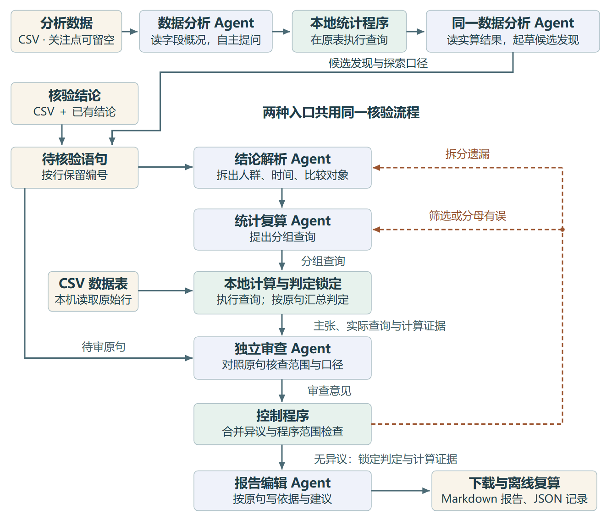
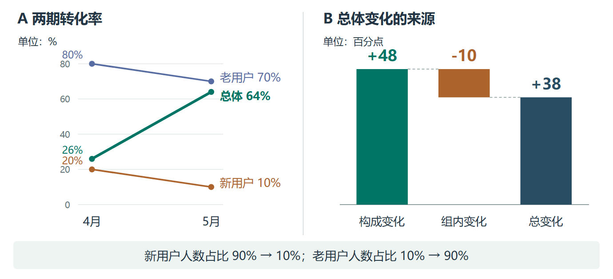

# 多 Agent 数据结论审查与复现系统

选题方向：方向三　多 Agent 协作系统（系统设计）

## 第一章　项目概述

本项目面向数据分析报告的撰写与复核，设计并实现了一个集表格数据分析与结论核验于一体的多 Agent 协作系统。

### 1.1 方向选择理由

提出一个有意义的问题与算对它的答案是两件事。分析者可能选错比较对象，或在草稿中写了“各组”却只计算总体。要发现这种偏差，另一角色需要对照原句、字段和实际查询提出异议，复算者还要能收到意见并修改条件。项目选择方向三“多 Agent 协作系统”，用独立审查约束分析者自己的发现，也让同一套协作机制能检查外部稿件。

### 1.2 项目目标

只有表格时，使用者应得到适合该表的发现及计算依据。已有稿件时，他应能查明每句是数据支持、与数据矛盾，还是证据不足。接手的人应能用原 CSV 重现主要计算，并知道哪些问题因字段缺失仍不能回答。

### 1.3 核心功能

系统可以根据表格中的字段自主提出分析问题，调用本地程序计算，再依据结果起草结论。系统生成的结论和用户提交的原句都要经过逐句核验。若原句涉及多个群体，审查时会检查计算是否覆盖了每个群体，发现遗漏便退回补算。用户可以查看判定理由和修订建议，也可以下载报告和计算记录，用原始数据独立复算。

## 第二章　系统设计

### 2.1 系统架构图



*图 1　分析入口先走上方的选题、计算、草拟三步；核验入口直接从已有原句开始。虚线表示异议退回。*

数据分析角色先读取字段类型、类别示例和数值范围，决定要比较什么。统计程序从原表执行这些探索查询，分析角色据实起草候选发现。草稿和它所指的人群、时间一同进入核验流程。已有稿件跳过探索；两条路径在这里共用四个角色，各自保留候选句和最后的判定。

### 2.2 模块说明

| 模块或角色 | 接收什么 | 实际交付 |
|---|---|---|
| 数据分析 Agent | 表格概况及可选关注点；随后为实际汇总值 | 带查询的分析问题，以及逐题候选发现 |
| 结论解析 Agent | 原句、字段和类别示例 | 带原句编号、人群、比较方向的原子主张 |
| 统计复算 Agent | 原子主张、上轮计算和反馈 | 规定格式的指标、分子分母与两侧筛选请求 |
| 本地统计程序 | 原 CSV 与结构化请求 | 匹配行数、实际分子分母、结果和数值比较 |
| 独立审查 Agent | 原句、拆分结果、实际执行的请求及证据 | 受影响的主张编号、异议、应补算的范围 |
| 报告编辑 Agent | 已核实的证据与锁定判定 | 每条原句的理由和可用的修订建议 |
| Web 端与记录 | 上传、模型事件与计算轮次 | 逐句页面、历史回放、Markdown 与 JSON 下载 |

每个成功计算的探索问题保留问题编号，并关联一条待核验的候选发现。字段不存在时控制程序要求修改请求；零分母等数据问题保留原因，仅有可计算证据的问题送去起草。一句话可对应多个原子主张，而原句编号保持不变。例如作者同时谈两类用户，编辑仍应交付对同一句话的审查结果，读者可以展开看到两份分组依据。系统保存模型提出的请求和程序实际执行的请求，因此人工删除筛选条件时也能查清改动发生在哪一步。

### 2.3 关键设计决策

按人群设置独立的左、右筛选条件，可以直接显示每一侧纳入了哪些行。只保存一个百分数会丢失分母，难以识别“本组人数”被换成“全体人数”的错误。为此，系统在计算时一起记录字段名、人数和命中行数。同一份记录也作为复核输入，避免编辑阶段重新猜测数字。

每条结论先由程序锁定判定，再交给编辑组织文字。各组均提升需要每个子主张成立；有一组被反证就能否定全称判断，某组缺数据且没有反证时则保留疑问。这样仍允许模型解释“不足在哪里”，又能防止一轮文字润色改变已经核实的判定。

## 第三章　实现细节

### 3.1 核心代码片段

`discovery.py` 的 `analyze` 首先检验并执行分析角色提出的查询。下列片段决定哪些问题可以产生草稿：

```python
usable = [q for q in questions if "result" in q]
if not usable:
    record["status"] = "无可核验发现"
    return record
texts = ask(dict(stage="draft",focus=focus.strip(),observations=usable),
            lambda out: checked_findings(out,usable))
for source,(q,text) in enumerate(zip(usable,texts),1):
    q.update(source=source,draft=text)
```

一题对应一个编号，成功计算才带有 `result`。若所有问题都没有可用数值，程序保留问题和受限原因，直接结束。可计算时，第二次分析请求同时取得问题、实际筛选条件、命中行数和数值。输出必须与成功问题逐项对应，之后才按序编号为原句。这个步骤防止模型为一次没有执行成功的查询填写发现。

在 `audit.py` 的 `audit` 中，当轮计算先产生可重放的证据。审查角色独立读取原句、实际查询与结果，程序另行检查群体范围。两者的意见在这里汇合：

```python
step["review"]=objections
step["program_checks"]=enrich_checks(rows,lines,atoms,actual,objections,scope_issues(atoms,actual))
feedback=objections+step["program_checks"]
```

原计算与审查意见有分歧时，程序回查两套口径命中的数据行、分子和分母。接受异议后补算，驳回异议后保留原计算，待确认的结论暂停定稿。若原句拆错，程序带着上一版主张交回解析；若筛选错，下一轮复算直接使用现有主张、具体反馈和上一轮的执行结果。记录中同时保留模型提出的请求和实际执行的请求，人工删除筛选造成的差别可以直接对照。重复分歧或达到三轮上限会停止定稿。

比例计算在 `stats.py` 中执行：先按月份、人群等条件同时选中行，再把这些行的部分人数及总人数分别求和后相除。不同组人数悬殊时，直接平均组内百分比会歪曲总体结果。缺字段、零分母、部分人数超过总人数都会产生明确原因；程序只接受规定的统计操作和等值条件。

### 3.2 关键配置

| 条件 | 配置与实验取值 | 影响 |
|---|---|---|
| 模型 | `DEEPSEEK_MODEL` 默认及实测均为 `deepseek-flash`；凭据变量 `DEEPSEEK_API_KEY` | 分析模式五个角色共用服务，核验模式使用其中四个 |
| 模型输出 | JSON 对象、温度 0；单次网络超时 90 秒 | 解析后检查必需字段和主张编号 |
| 自主选题 | 每表 1—3 个问题；两侧比较只改变一个维度 | 固定其余限定，防止拿一个品类和所有品类作错位比较 |
| 运行边界 | 最多 3 轮复算；结构错误可带反馈重试一次 | 分歧重复或达到上限时停止定稿 |
| 数据范围 | UTF-8 CSV，最多 1 MB、10000 行、40 列 | 在本机执行计数、合计、均值、人数比例 |
| 对照实验 | 核验模式使用四行 CSV 和六条冻结原句 | 两种基线共用统计引擎；五角色另用转化表与销售表验收 |

模型取得字段、类别示例和需要核对的汇总结果。完整数据由本机读取。用户可将自然语言原句分行上传，其中一行即使包含多个比较，也只占一个最终判定。导出记录带有原始文件字节的指纹，换行或编码改变也会被识别为不同输入。一次运行中的服务耗时按实际调用累计，程序的本地计算和网页展示时间没有计入该数值。自主分析的导出记录额外保留探索查询、结果、问题编号与候选句的对应关系。离线程序先重算探索数值并核对候选句，再使用原有逻辑重算核验阶段，从而与仍可回放的旧记录兼容。

### 3.3 遇到的问题与解决

早期单角色基线在最后一步失败。六条原句中，“新用户和老用户的转化率从4月到5月均有提升”需要分别核对新用户和老用户，因此产生七个原子计算，但撰稿人仍只需要六条逐句意见。日志显示计算已经完成，编辑却按七个原子编号各交付一条意见。即使两项分组判断都正确，这样的回答也无法直接对应分析稿中的第二句。

程序发现交付数量和编号不合要求，带着错误提示重试一次，仍未得到有效定稿。修正编辑提示后，单角色基线从头重跑，按原句编号合并两组证据，交付六条判定、依据和建议。此前失败试跑的三次调用另行保存。自主分析联调还发现，跨类别比较有时会把一侧的类别误当作两侧应共有的条件，程序因此停在待人工核查。最终实现把实际探索查询的共同限定交给核验角色作参考，要求重新提出查询并独立审查。保留的失败记录与正式验收分别统计。

## 第四章　测试验证

### 4.1 测试用例

自主分析验收通过 Web 仅提交 CSV：一张转化表，另一张六行销售表。另测带关注点的提交。下表六句只用于“核验结论”模式。

自建转化表有四行，每行记录一个月份、一类用户的人数及其中的转化人数。四月的新、老用户各有 180 人和 20 人，五月两组人数互换。表中保留了测试原句及运行前冻结的人工答案；模型没有接收答案。

| 序号 | 测试原句 | 判定依据 | 参考答案 |
|---|---|---|---|
| 1 | 总体转化率从4月到5月上升。 | 4月 52/200 = 26%，5月 128/200 = 64% | 数据支持 |
| 2 | 新用户和老用户的转化率从4月到5月均有提升。 | 新用户 36/180 → 2/20；老用户 16/20 → 126/180 | 与数据矛盾 |
| 3 | 5月新用户的转化率为1%。 | 5月新用户 2/20 = 10%；2/200 = 1% 使用了全体人数 | 与数据矛盾 |
| 4 | 5月女性用户的转化率高于男性用户。 | 表中只有月份、用户类型、人数和转化人数，缺性别 | 证据不足 |
| 5 | 5月的页面改版导致总体转化率上升。 | 没有页面改版干预记录和可识别的对照 | 证据不足 |
| 6 | 5月老用户的转化率为70%。 | 5月老用户 126/180 = 70% | 数据支持 |

### 4.2 测试结果

**只传 CSV 的五角色运行。** 销售表字段为“产品类别、季度、销售额”。关注点留空，Agent 自问“一季度与二季度的销售额合计哪个更高？”，本地按季度分别加总三行，得到 40000 和 45000。它起草“二季度的销售额合计高于一季度。”独立核验支持该句。转化表则自主选了五月新用户转化率等问题，计算出 2/20 = 10%。两次均经六次请求完成，导出后各重放六项查询。另填关注点后，系统优先比较文具（12000 → 15000），指出缺少月份，无法判断逐月趋势。


*图 2　销售分析真实 Web 回放局部。三个问题由分析角色提出，下方各行显示对应筛选与汇总。*

**“核验结论”模式的自然对照。** 在同一份数据、同一模型和相同统计工具下，单角色与四角色均判对 6/6。单角色用了两次模型请求，四角色用了四次，两者都在首次计算时选对了分组。

**深度突破候选：审查统计口径并据异议修订。** 核验模式单独取第 2 句，人工删除首轮查询两侧的用户类型筛选。首轮两组共用分母 200。审查 Agent 分别指出两个比较都漏了用户类型，程序范围检查也报告了不一致。合并反馈进入下一轮后，新用户由 20% 降至 10%，老用户由 80% 降至 70%，当轮判定从“证据不足”变为“与数据矛盾”。异议确实改变了查询和判定，两项检查的作用未分别消融。


*图 3　人工注入实验的真实 Web 回放。该实验单独提交六条测试原句中的第 2 句，因此页面显示为“原句 1”。对照两轮中每侧命中的行数，可看到分母从全体人数变为组内人数。*

**方向突破候选：导出的计算证据可离线复现。** 下表为核验模式的复现实验。两种入口均完成真实上传、下载和复算。加入趋势分解与分歧裁决后，66 项离线测试全部通过。

| 操作 | 实际结果 |
|---|---|
| 用原 CSV 重放七条查询 | 逐项计算结果和逐句判定均一致 |
| 仅改 CSV 中一行的人数 | 文件指纹不符，停止复算 |
| 保持 CSV 不变，仅改导出记录中的一个分母 | 重算结果与记录不一致，校验失败 |

**趋势分解与分歧裁决。** 转化数据的总体转化率从 26% 升至 64%，新用户和老用户的组内比率各下降 10 个百分点。人数构成变化贡献 +48 个百分点，组内变化贡献 −10 个百分点。五个配对用例中，新旧版本均纠正两项口径错误并保留两个正确计算。新版当轮驳回把组内分母换成全体人数的建议，并将群体指代不明的一例交回确认。



*图 4　转化表的真实运行结果。左侧单位为百分比，右侧单位为百分点。*

### 4.3 用户反馈

**作者：** 在销售分析页面，我可以从季度比较问题直接跳到核验结果，对照两个季度的销售额，检查报告里的结论是否与原表一致。还是比较方便的

**同学一（从撰稿人角度出发）：** 我改稿时页面建议把“均有提升”改为“均有下降”，旁边列出了新用户从 20% 降到 10%、老用户从 80% 降到 70%。感觉还是比较可靠的

**同学二（从复核人角度出发）：** 核对五月新用户转化率时，页面列出五月有 20 名新用户，其中 2 人转化，所以是 2/20，也就是 10%。让我能快速确认是否取对数字了，挺好的。

## 第五章　总结反思

### 5.1 项目亮点

一条结论被退回时，读者可以看到审查角色指出的是哪一组人、哪一侧少了筛选条件。即使原句有两个比较，下载后仍能对照原句找到两条计算记录。这使得修改文稿和复查计算可以由不同的人完成。对缺性别字段的结论，系统也能给出下一步所需的数据，而不以总体结果填补空缺。

### 5.2 不足与改进方向

当前能够检查的是规则明确的描述统计。近似相等、显著性检验和跨表关联都需要更丰富的口径约定，后续可先提供精度与允许误差的显式选项，再为加权均值和区间估计增加独立测试。趋势分解当前比较两个可比时期，要求两期覆盖相同组别且各组分母有效。后续可增加连续多期分解，再用缩写字段、缺失数值及混合粒度的样例检验口径识别。

### 5.3 个人收获

我对“证据支持一句话”的理解从算对百分比延伸到了说明这个百分比属于谁。总体上升与组内下降能同时成立，说明分组限定本身就是结论的一部分。我也学到要分开评价协作的两种作用：在注入故障时能否救回错误，以及在自然运行已正确时要额外付出多少调用。只有把两种结果放在一起，才能解释何时值得安排独立审查。

---

开发工具说明：项目使用 Codex 辅助开发、执行验证和整理报告；样例与参考答案为本课程自建。DeepSeek 承担分析和核验中的语言角色，本地 Python 程序执行统计和离线复算。
